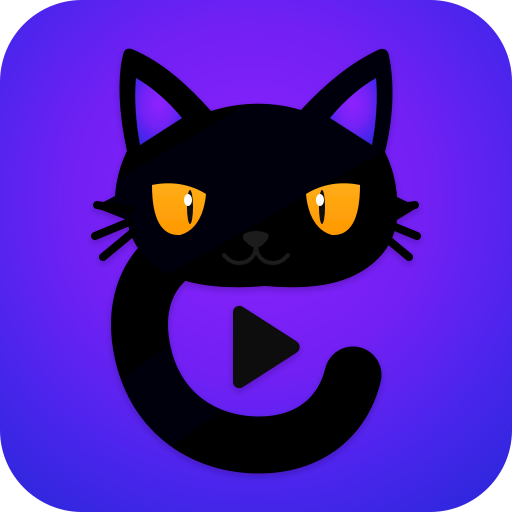

<h1 align="center">OneTrackCat</h1>

<p align="center">
  
</p>

<p align="center"><strong>OneTrackCat — the one trick you need to turn gameplay into highlights.</strong></p>

OneTrackCat is a local gameplay video editor for Linux. Remove quiet stretches, repeat the
best moment, slow down or zoom the action, add text and reaction media, and export a finished
video without an account or an upload.

## What you can do

- Cut out unwanted moments with a few marks.
- Replay a highlight, change its speed, zoom it, or freeze a frame.
  Replay repeats the footage at half speed and carries over face blur. Other effects aren't copied, but text and effects spanning the replay stay active.
- Add text, pictures, GIFs, reaction videos, sounds, and simple transitions.
- Make a regular landscape video or a 9:16 Short.
- For Shorts, use the arrows above the timeline to set the frame position at the playhead. The frame moves smoothly between these points; click a diamond to return to one.
- Blur, pixelate, or mask faces with the optional local face pack.
- Upscale video to 4K and create smoother 60 fps motion with the optional Upscale pack.
- Recreate your own narration with clearer wording and your voice using the optional voice pack.
- Undo and redo your editing.

## Requirements

- Ubuntu 26.04
- GNOME running on Wayland
- A 64-bit computer

OneTrackCat is currently developed and tested for this setup. Other Linux desktops, X11,
Windows, and macOS are not supported at this time.

### Hardware for optional packs

| Feature | Graphics requirements | Recommended computer memory (RAM) |
| --- | --- | --- |
| Face blur (face pack) | Intel graphics recommended; also works on the CPU, more slowly. | 8 GB; 16 GB for 4K video. |
| Re-voice (voice pack) | Intel Arc B580 with 12 GB of graphics memory tested; slower CPU fallback. | 16 GB minimum; 32 GB recommended. |
| 4K upscaling (Upscale pack) | Intel Arc graphics card with **at least 12 GB of graphics memory**. Tested with B580 (12 GB) and A770 (16 GB). Cannot run on the CPU. | 32 GB. |
| Smoother motion at 60 fps (Upscale pack) | Intel graphics recommended; also works on the CPU, more slowly. Fast processing at 4K can need about 10 GB of graphics memory. | 16 GB; 32 GB for 4K video. |

Graphics memory is separate from your computer's RAM on a dedicated graphics card.
Built-in Intel graphics shares RAM instead. AMD and NVIDIA graphics are not supported for
these optional effects; face blur and smoother motion can use the CPU instead, but 4K upscaling cannot.
Ordinary editing does not require a supported graphics card.

These memory figures are recommendations, not guaranteed minimums. Close other memory-heavy
programs before optional-effect exports, and leave free disk space for temporary files. OneTrackCat
checks disk space before starting. Models download on first use and stay installed for future
projects. Downloads show progress and can be cancelled and resumed.

## Install and open OneTrackCat

1. Download the OneTrackCat AppImage from [Releases](https://github.com/mstasenko/one-track-cat/releases).
2. In Files, right-click the AppImage and choose **Properties**.
3. Open **Permissions** and enable **Allow executing file as program**.
4. Close the Properties window and double-click the AppImage.

Run OneTrackCat as your normal user. You do not need `sudo` or an administrator account.

### Re-voice

Choose **Effects → Re-voice** to work on the marked section, or the whole
video when nothing is marked. Click **Recognize**; language is detected automatically.
Leave **Recognition audio** on **Original**, or try **Cleaned speech** if background
sounds interfere with recognition.
**Speech detection** skips silence and noise. Leave it on **Balanced**, use
**Sensitive** for quiet speech, or **Strict** if too much background noise is picked up.
Enable **Translate to English** before Recognize to recreate the narration in English.
It is off by default.
Recognize cleans up the wording in timed blocks, leaving filler empty where appropriate. Optionally open **Edit transcript**
to adjust it; **Apply** saves your edits without generating speech.
Adding marks automatically divides the transcript view into sections without recognizing again.
Each whole block belongs to the section where it starts; its speech can continue past a mark.
Your wording, timestamps, and existing audio stay intact. Generating after an edit reuses unchanged speech.
Leave a block empty to skip its narration while keeping the background sounds.
Choose a voice style: **Original**,
**Conversational**, **Cosy**, **Calm**, **Professional**, or **Energetic**.
**Conversational** gives relaxed pacing with varied intonation. Start with **Original** for
the closest match to your recorded delivery. Other styles can change the tone
more noticeably. Click **Generate** to recreate the speech in your voice.
The first section you revoice sets the shared voice sample, using up to 60 seconds
of original audio from that point. Only the selected section is rewritten.
**Even voice volume**, enabled by default for new effects, smooths loudness differences in the new narration.
**Slowdown (%)** defaults to 0%. Increase it for a more relaxed pace; OTC reduces
the slowdown when needed to keep speech in sync.
Enable **Subtitles** before Generate to add large, readable lines timed to the
generated speech. It is off by default. Subtitles follow your Re-voice transcript; regenerate after editing it.
**Background** keeps the original environment at 100%, lowers it below that,
or mutes it at 0%. Click **Generate** after changing these settings; previously
generated speech is reused when only the mix changes.
Use **Original / AI narration** to compare in
the timeline preview. Export reuses the result without generating it again.

Your video timing stays unchanged. Shorter narration leaves the original
environmental sounds in the remaining pause. Add `[500ms]` or `[1s]` in the
transcript for a deliberate pause; these markers stay out of subtitles.
If a phrase cannot fit, shorten its highlighted wording and use **Retry generation**
in the editor. Earlier generated
lines stay read-only during a retry. Style guidance is approximate. Listen for missed speech or unwanted
background changes before exporting; separation is not perfect.

Use the editor's **Undo / Redo** to remove or restore Re-voice. Redo reuses the
generated audio without processing it again.

Re-voice is included in this release but requires the optional voice pack. Extract
`otc-voice-pack.zip` beside the app (into `dist` for development).
The button is unavailable until the pack is installed. The first **Recognize**
downloads about 13 GB of models; allow at least 17 GB of free space.
Later use works offline, without downloading or converting models again.

## Optional media packs

The media pack adds ready-to-use reaction images, clips, and sounds. The face pack adds the
**Blur faces** effect. The Upscale pack adds optional video enhancement. The voice pack adds
**Re-voice**. Download the packs you want
from the same release as your app and extract them beside the AppImage.

```text
one-track-cat/
├── OneTrackCat-...AppImage
├── meme/
├── face-pack/
├── upscale-pack/
└── voice-pack/
```

You can use OneTrackCat without any packs and add your own media with **New**. The packs are
optional downloads; license notices are included inside each pack.
Runtime packs keep large model weights separate from their ZIP files, and the app downloads
the weights it needs on first use.
Face blur downloads about 109 MB on first use. Existing face packs with bundled
weights still work offline. Updating a runtime pack does not require downloading
unchanged models again; resetting a project does not delete installed models.

## A simple editing workflow

1. Drop a gameplay video into OneTrackCat or choose **Open**.
2. Move the playhead and add marks around a moment.
3. Click inside a section, then choose **Remove Marked**, **Speed**, **Zoom**, **Freeze**, or **Replay**.
4. Add text, a picture, a reaction clip, or a sound from the side panel.
5. Choose **Export**, click **Start**, and select where to save the finished video.

In the video chooser, hover over a clip for a short, silent preview. **Browse…** opens
the usual file dialog. **Clear left mark** and **Clear right mark** remove that
boundary of the highlighted section without deleting video. They show **×←** and
**×→** in narrow windows.

Search **Images** for local pictures, blank templates from
[MemeFact on Hugging Face](https://huggingface.co/datasets/sergiogpinto/memefact-templates)
and [Imgflip](https://imgflip.com/api), and ready-made captioned memes from
[IMKG](https://memes.science/). You can search their captions, too. **Videos** searches local
clips and animated Imgflip memes. Online matches appear in the same list with a small
globe. Hover to preview, click the name to download and add it, or click the globe to visit
its source. Selected templates stay on your computer while you edit the project. If a service is
unavailable, choose **Retry online search**. Your videos and project are never uploaded.
Memes and templates have their own usage rights; check the source before publishing, especially for
commercial use. No account or paid API is needed.

Effects apply to the section containing the playhead when marks are present. With no marks,
they apply to the entire video.

Choose **Effects → Transition** to fade or blur a section. Pick an effect and **In** or **Out**;
the effect uses the selected section's full duration.
After inserting a video, the playhead moves to its end so you can insert the next clip there.
Inserted-video transitions overlap the two clips while both play, shortening the combined
video by the overlap duration. Long transitions automatically fit the clips.

### Face blur

Choose **Effects → Blur faces**, choose a style, and click **Apply face blur**. OneTrackCat renders
a preview of the selected section, or the whole video when there are no marks. The rendered
result appears in the main preview while the playhead is inside that range; move outside it to
see the original video again. OneTrackCat keeps the current position and stays paused after the
render finishes, so no separate preview window opens or starts playing by itself.
The latest rendered preview is restored when you reopen an unchanged project, as long as
its cached video is still available. If it is unavailable, use **Apply face blur** again.
To edit an existing face-blur range, click its **Face blur** band in the timeline; this selects
its settings without moving the playhead.
Face-blur ranges appear on the timeline. Export reuses the preview's face analysis when the
footage and detection settings have not changed during the same app session. Export still
needs to apply the effect and encode the finished video.

- **Sensitivity** balances missed faces against extra detections. The default 1% is strict;
  increase it if real faces are missed.
- **Small faces** looks for smaller faces and may take longer.
- **Hold missed faces** extends an existing mask through short detection gaps (0.3 seconds
  by default, up to 2 seconds). It cannot cover a face before its first detection or a longer gap.
- **Strength** and **Style** control how strongly the face is hidden.

Automatic detection can miss faces; check the preview before sharing.

If hardware processing is unavailable or a permission prompt is declined, OneTrackCat falls back
to CPU processing. Your project and media stay on your computer.

### Upscale

In **Export**, choose an option under **Upscale** before clicking **Start**. It is off by default
and requires the optional Upscale pack. Choose **Turbo** for faster processing or **Base** for
more detail. Upscaling applies to the finished video, including its text and effects.
When updating OneTrackCat, extract the matching Upscale pack too; downloaded weights are reused.
4K upscaling supports landscape 3840×2160 videos and vertical 2160×3840 Shorts, and
requires a supported Intel discrete GPU. Select **60 fps** to use frame interpolation
throughout the video. This option is disabled only when every used clip is above
59 fps, accounting for playback speed. Unused imports do not affect it.
A video already at 4K and 60 fps needs neither unless it has close-ups. For a 4K video
with **Zoom** effects, 4K upscaling processes only those close-ups, not the unchanged sections.
This also applies to Shorts made from 4K footage: only the visible Short area is processed,
and Upscaling runs only during close-ups. Lower-resolution footage is enhanced throughout.
In **Zoom**, use **Transition (seconds)** to set how long zoom-in and zoom-out take;
short close-ups automatically use shorter transitions.
Choose **View → Circle** to highlight an area without magnifying the frame. Its red outline
has a black border; **Draw circle (seconds)** controls how quickly the outline appears.

On first use, OneTrackCat offers to download the upscale model and shows its progress.
Allow about 12 GB of free space to set up a mode. Exports also need temporary disk space;
OneTrackCat checks this before starting. After setup, enhancement works offline; your videos
are never uploaded.

Upscaling takes extra time. It can improve
detail and motion, but cannot recover every detail missing from the original. Your video stays
on your computer, and no enhanced preview files are kept in your project.

## Saving your project

OneTrackCat autosaves the open project while you work, before export, and when it closes normally.
Use **Project → Reset project** to forget the saved project and start over. Exported videos are
ordinary files in the folder you choose.
Opening a new video or resetting the project clears the previous project's face-blur previews
and analysis. Reopening the saved project keeps them so you can continue where you left off.

## Keyboard shortcuts

| Key | Action |
| --- | --- |
| Space | Play or pause |
| Left / Right | Move five seconds |
| Shift+Left / Shift+Right | Previous / next frame |
| Mouse wheel over the timeline | Zoom the timeline |
| Delete | Remove the selected item or marked section |
| Ctrl+Z | Undo |
| Ctrl+Shift+Z | Redo |

Shortcuts are disabled while face blur is being applied or a video is being exported.

## Development

See [DEVELOPMENT.md](DEVELOPMENT.md) for developer setup, builds, tests, optional pack creation,
and implementation notes.

## License

OneTrackCat source code is licensed under [GPL-3.0-only](LICENSE). Optional media, face, Upscale,
and voice packs, plus bundled fonts, retain the licenses listed in their manifests and license files.
